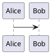

# PlantUML Export

[中文](#中文) | [English](#english) | 完整中文文档 / Full Chinese docs: [简体中文](README.zh-CN.md)

本地 PlantUML 导出工具链（Rust CLI + LSP）与轻量 Zed 扩展，将已保存的图表导出为 SVG / PNG / PDF。
A local PlantUML export toolchain (Rust CLI + LSP) with a thin Zed extension that exports saved diagrams to SVG / PNG / PDF.

---

# 中文

## 状态

早期项目，不再维护。最后发布为 GitHub 预发布版 `v0.1.0-rc.1`（[Releases](https://github.com/dahuangggg/plantuml-export/releases) 中包含六个平台的原生 helper 与 `SHA256SUMS`）。未上架 Zed Gallery，也没有 npm / Homebrew / Cargo registry 包。

## 功能

- 原生 CLI：`plantuml-export export`、`plantuml-export check`、`plantuml-export health`、`plantuml-export version`，以及供 Zed 使用的内部命令 `plantuml-export lsp`。
- 支持已保存的 `.puml`、`.plantuml`、`.pu`、`.iuml`、`.wsd` 文件；遵循 `.gitignore` 的工作区发现，输出路径镜像源路径（默认 `out/`）。
- 三种显式渲染模式：`managed`（默认，首次使用时下载并校验固定版本的 PlantUML `1.2026.6` JAR 与 Temurin JRE `21.0.11+10` 到本地 cache，JAR SHA-256 为 `89948f14c93756c7a3fb7b69078ff37e8489fd79dd430c582b931e2f65358690`）、`binary`、`jar`；默认 Smetana 布局，可选 Graphviz。
- 事务式多文件导出：所有权清单、回滚与中断恢复；状态保存在输出目录之外（如 macOS 的 `~/Library/Application Support/plantuml-export/exports/`）。
- 远程 include 策略 `public` / `allowlist` / `disabled`（对应 PlantUML 的 `INTERNET` / `ALLOWLIST` 安全配置），以及离线模式。
- Zed 扩展：语法、查询、snippet，语言服务器 `plantuml-lsp` 提供结构诊断、保存时语法检查，以及通过 `workspace/executeCommand` 执行的 SVG/PNG/PDF 导出 Code Action。
- 不包含实时预览、保存时导出、遥测与服务器渲染；Markdown 中的 PlantUML 代码块仅由 Zed 内置注入做语法高亮，CLI 不导出。

## 技术栈

- Rust 1.96.0（`rust-toolchain.toml`）：CLI / LSP 位于 `crates/plantuml-export`（clap、lsp-server、ureq 等）。
- Zed 扩展：Rust + `zed_extension_api`，编译为 `wasm32-wasip2`；语法来自 tree-sitter-plantuml。
- PlantUML + Java（managed 模式自动管理）；可选 Graphviz。
- Node.js 仅用于仓库测试与发布检查脚本（`node --test`），不是运行时依赖。
- GitHub Actions：CI 与六平台原生 helper 发布。

## 快速开始

在 Zed 中作为开发扩展安装（需要 Git、Zed、`rustup`）：

```bash
git clone https://github.com/dahuangggg/plantuml-export.git
cd plantuml-export
rustup toolchain install 1.96.0 --profile minimal --component rustfmt --component clippy
rustup target add --toolchain 1.96.0 wasm32-wasip2
```

然后在 Zed 命令面板运行 **Zed: Install Dev Extension**，选择包含 `extension.toml` 的目录；打开已保存的 PlantUML 文件，按 `Cmd-.` / `Ctrl-.` 选择导出 Code Action。

本地构建并运行 CLI（首次 managed 渲染会下载约 66–78 MiB 的 JAR + JRE）：

```bash
cargo build --locked -p plantuml-export-cli
./target/debug/plantuml-export health --json
./target/debug/plantuml-export check examples/sample.puml --json
./target/debug/plantuml-export export examples/sample.puml --format png
```

可选的项目配置文件 `plantuml-export.toml`（放在工作区根目录）：

```toml
renderer = "managed"
format = "svg"
outDir = "out"
layout = "smetana"
remoteIncludes = "public"
```

开发检查：

```bash
cargo fmt --all -- --check
cargo clippy --locked --workspace --all-targets -- -D warnings
cargo test --locked --workspace --all-targets
cargo build --locked --target wasm32-wasip2 --target-dir target
npm test
npm run check:release-package
```

## 目录结构

```text
crates/plantuml-export/  原生 CLI、渲染器、导出事务与 LSP（含集成测试）
extension/src/           Zed 扩展（Wasm），负责下载并校验原生 helper
languages/plantuml/      Zed 语言配置与 tree-sitter 查询
snippets/                PlantUML 代码片段
examples/                示例图表 sample.puml
docs/                    架构、安全、规格与发布清单
release/                 原生 helper 元数据与发布说明
scripts/                 发布元数据生成与冒烟测试脚本
test/                    Node 仓库/发布契约测试与夹具
```

更多细节见 [README.zh-CN.md](README.zh-CN.md)、[docs/security.md](docs/security.md)、[docs/architecture.md](docs/architecture.md)、[CHANGELOG.md](CHANGELOG.md)、[SECURITY.md](SECURITY.md)。

## 许可证

项目代码使用 [MIT](LICENSE) 许可证。managed 模式下载的 [Eclipse Temurin](https://adoptium.net/docs/faq)（GPL-2.0 with Classpath Exception）和 [PlantUML](https://plantuml.com/download) 遵循各自许可证。

---

# English

## Status

Early project, no longer actively maintained. The last release is the GitHub prerelease `v0.1.0-rc.1` ([Releases](https://github.com/dahuangggg/plantuml-export/releases) hold six native helpers plus `SHA256SUMS`). It is not listed in the Zed Gallery and has no npm, Homebrew, or Cargo registry package.

## Features

- Native CLI: `plantuml-export export`, `plantuml-export check`, `plantuml-export health`, `plantuml-export version`, plus the internal `plantuml-export lsp` used by Zed.
- Saved `.puml`, `.plantuml`, `.pu`, `.iuml`, and `.wsd` files; ignore-aware workspace discovery with mirrored output paths (default `out/`).
- Explicit renderer modes: `managed` (default; on first use downloads and verifies the pinned PlantUML `1.2026.6` JAR and Temurin JRE `21.0.11+10` into a local cache, JAR SHA-256 `89948f14c93756c7a3fb7b69078ff37e8489fd79dd430c582b931e2f65358690`), `binary`, and `jar`. Smetana layout by default, Graphviz optional.
- Transactional multi-file export with an ownership manifest, rollback, and crash recovery; state lives outside the output directory (e.g. `~/Library/Application Support/plantuml-export/exports/` on macOS).
- Remote-include policy `public` / `allowlist` / `disabled` (PlantUML `INTERNET` / `ALLOWLIST` security profiles) and an offline mode.
- Zed extension: grammar, queries, snippets, and the `plantuml-lsp` language server with structural diagnostics, save-time syntax checks, and SVG/PNG/PDF export Code Actions run via `workspace/executeCommand`.
- Out of scope: live preview, export-on-save, telemetry. Server rendering is intentionally not part of this phase. PlantUML fences in Markdown rely on Zed's built-in Markdown fenced-code injection for highlighting only; the CLI does not export them:



## Tech stack

- Rust 1.96.0 (`rust-toolchain.toml`): CLI / LSP in `crates/plantuml-export` (clap, lsp-server, ureq, ...).
- Zed extension: Rust + `zed_extension_api`, compiled to `wasm32-wasip2`; grammar from tree-sitter-plantuml.
- PlantUML + Java (managed automatically in `managed` mode); optional Graphviz.
- Node.js only for repository tests and release checks (`node --test`); not a runtime dependency.
- GitHub Actions for CI and six-platform native helper releases.

## Getting started

Install as a Zed dev extension (requires Git, Zed, and `rustup`):

```bash
git clone https://github.com/dahuangggg/plantuml-export.git
cd plantuml-export
rustup toolchain install 1.96.0 --profile minimal --component rustfmt --component clippy
rustup target add --toolchain 1.96.0 wasm32-wasip2
```

Then run **Zed: Install Dev Extension** from the command palette and select the directory containing `extension.toml`. Open a saved PlantUML file and press `Cmd-.` / `Ctrl-.` to pick an export Code Action.

Build and run the CLI locally (the first managed render downloads about 66–78 MiB of JAR + JRE):

```bash
cargo build --locked -p plantuml-export-cli
./target/debug/plantuml-export health --json
./target/debug/plantuml-export check examples/sample.puml --json
./target/debug/plantuml-export export examples/sample.puml --format png
```

Optional project config `plantuml-export.toml` at the worktree root:

```toml
renderer = "managed"
format = "svg"
outDir = "out"
layout = "smetana"
remoteIncludes = "public"
```

Development checks:

```bash
cargo fmt --all -- --check
cargo clippy --locked --workspace --all-targets -- -D warnings
cargo test --locked --workspace --all-targets
cargo build --locked --target wasm32-wasip2 --target-dir target
npm test
npm run check:release-package
```

## Directory structure

```text
crates/plantuml-export/  Native CLI, renderer, export transactions, LSP (with integration tests)
extension/src/           Zed extension (Wasm); downloads and verifies the native helper
languages/plantuml/      Zed language config and tree-sitter queries
snippets/                PlantUML snippets
examples/                Sample diagram sample.puml
docs/                    Architecture, security, spec, release checklist
release/                 Native helper metadata and release notes
scripts/                 Release metadata generation and smoke-test scripts
test/                    Node repository/release contract tests and fixtures
```

See [README.zh-CN.md](README.zh-CN.md), [docs/security.md](docs/security.md), [docs/architecture.md](docs/architecture.md), [CHANGELOG.md](CHANGELOG.md), and [SECURITY.md](SECURITY.md) for details.

## License

Project code is [MIT](LICENSE). Managed mode downloads [Eclipse Temurin](https://adoptium.net/docs/faq) (GPL-2.0 with the Classpath Exception) and [PlantUML](https://plantuml.com/download) under their own license terms.
